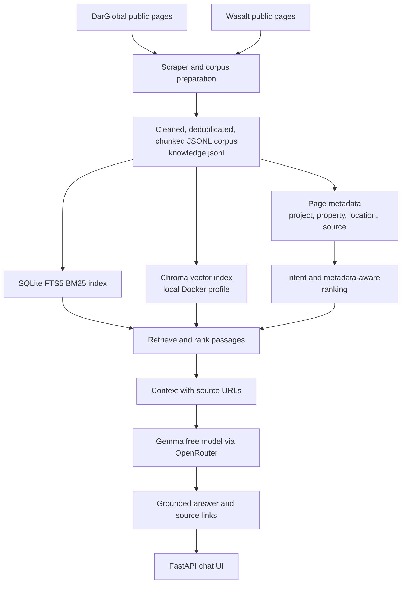
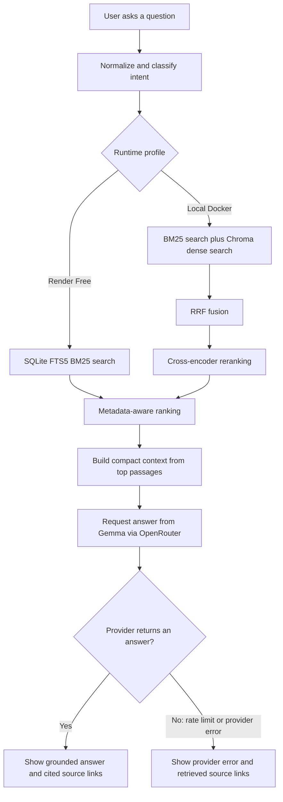

# DarGlobal + Wasalt Assistant

A source-grounded chatbot for public information collected from DarGlobal and Wasalt. The app retrieves relevant passages from a local corpus, asks Gemma through OpenRouter to answer from those passages, and returns links to the source pages.

## What the app does

- Crawls public pages from the two configured sites: [DarGlobal](https://darglobal.co.uk/) and [Wasalt corporate](https://wasalt.sa/en/corporate).
- Cleans and chunks page text into a JSONL corpus. The current corpus contains 9,261 chunks; the exact count can change after a new crawl.
- Finds passages with both SQLite FTS5 BM25 keyword search and multilingual dense search in Chroma.
- Combines and reranks candidates with Reciprocal Rank Fusion (RRF), a cross-encoder, and page metadata for project, property, and location intent.
- Sends the retrieved context to **Gemma 4 31B Free** through OpenRouter. The model is pinned; the app does not switch to other models or generate extractive fallback answers. If OpenRouter is unavailable or rate-limited, it shows an error and the retrieved source links.
- Runs as a Docker container with a browser chat UI and a health endpoint.

## System architecture

The corpus is prepared before deployment and included with the application. At runtime, the app builds its searchable indexes from that corpus. The local Docker profile and the Render Free profile use different retrieval components because Render Free has a much smaller memory budget.



**Render Free profile:** `VECTOR_SEARCH_ENABLED=false`, so it uses SQLite FTS5 BM25 and metadata-aware ranking. It does not run Chroma, dense embeddings, RRF, or the cross-encoder. **Local Docker profile:** uses BM25 plus Chroma dense retrieval, RRF fusion, cross-encoder reranking, and metadata-aware ranking. Both profiles use the same prepared corpus and OpenRouter model configuration.

## Query flow



The provider-error path is intentional: the app does not switch models or fabricate a fallback answer. A free OpenRouter model can be rate-limited independently of whether the application and retrieval are healthy.

## How retrieval and answers work

1. `scrape.py` follows same-domain links and same-domain sitemaps listed by `robots.txt` for the URLs in `data/sources.json`. It observes `robots.txt`, waits one second between pages, caps crawling at 1,500 pages per host, skips account and non-HTML paths, and does not bypass access controls.
2. `app/corpus.py` normalizes text, removes duplicate lines/sentences, redacts email addresses and Saudi mobile numbers, and chunks text. `prepare_corpus.py` merges crawler fragments and rechunks the existing corpus.
3. `prepare_page_metadata.py` writes `data/page_metadata.json`, identifying page types and distinguishing project locations from event or incidental city mentions.
4. At query time, SQLite FTS5 provides BM25 candidates and Chroma provides dense candidates using `intfloat/multilingual-e5-small`. RRF fuses the candidate lists; `cross-encoder/mmarco-mMiniLMv2-L12-H384-v1` reranks them. Metadata adds small intent-aware source-ranking adjustments.
5. The highest-ranked passages and source URLs are sent to `google/gemma-4-31b-it:free` through OpenRouter. The request disables optional reasoning to reserve output tokens for the answer. The assistant is instructed to answer from the supplied sources and cite them.

The JSONL corpus is the source of truth. SQLite FTS5 is built from that corpus and refreshed when it changes. Chroma stores the embeddings in the persistent Docker volume `chroma_store`. On a new deployment, build the vector index once before serving requests, or let the first question trigger indexing. Indexing downloads the embedding model and can take several minutes on CPU; the cross-encoder reranker is loaded on the first chat request.

## Requirements

- Windows with Docker Desktop and Docker Compose, or another Docker-capable environment.
- An OpenRouter API key. The configured Gemma model is free, but free endpoints can be rate-limited or temporarily unavailable.
- Internet access for the initial Docker build, model downloads, crawling, and OpenRouter requests.

## Run locally with Docker

From the project directory in PowerShell:

```powershell
Copy-Item .env.example .env
notepad .env
```

Set `OPENROUTER_API_KEY` in `.env`. Keep `OPENROUTER_MODEL=google/gemma-4-31b-it:free` to use Gemma only. Do not commit `.env`.

To build the Chroma index before starting the web app, run:

```powershell
docker compose run --build --rm --no-deps chatbot python -m app.vector_store
```

This step is optional. If skipped, the app builds the index when it receives its first chat question. Start the app with:

```powershell
docker compose up --build -d
```

Open [http://localhost:8000](http://localhost:8000). Check startup and indexing logs with:

```powershell
docker compose logs -f chatbot
```

Check the service and index counts at [http://localhost:8000/health](http://localhost:8000/health). FastAPI's interactive API documentation is at [http://localhost:8000/docs](http://localhost:8000/docs). The chat endpoint is `POST /chat` with JSON such as `{"message":"What is the AIDA project?"}`.

Stop the app with `docker compose down`. This preserves the Chroma volume. Avoid `docker compose down -v` unless you intend to delete the vector index and rebuild it.

## Configuration

| Variable | Purpose | Default |
| --- | --- | --- |
| `OPENROUTER_API_KEY` | OpenRouter credential; required for answers | none |
| `OPENROUTER_MODEL` | The single model used for generation | `google/gemma-4-31b-it:free` |
| `OPENROUTER_TIMEOUT_SECONDS` | OpenRouter request timeout | `35` |
| `APP_NAME` | App title sent to OpenRouter | `DarGlobal + Wasalt Property Assistant` |
| `APP_PUBLIC_URL` | Public app URL sent as OpenRouter request metadata | `http://localhost:8000` |
| `EMBEDDING_MODEL` | Sentence Transformer used for dense retrieval | `intfloat/multilingual-e5-small` |
| `RERANKER_MODEL` | Cross-encoder used to rerank retrieval candidates | `cross-encoder/mmarco-mMiniLMv2-L12-H384-v1` |
| `VECTOR_INDEX_MAX_CHUNKS` | Optional cap for local experiments; `0` indexes all chunks | `0` |

Compose sets `CHROMA_PATH=/app/vector_store` and persists it in the `chroma_store` volume. It also mounts the host `data/` directory at `/app/data` for the corpus, metadata, BM25 index, and model cache.

## Refresh the collected corpus

The crawler overwrites `data/knowledge.jsonl`. Back up the current corpus outside the project before running a new crawl:

```powershell
Copy-Item data/knowledge.jsonl "$env:TEMP\darglobal-knowledge-before-refresh.jsonl"
python -m pip install -r requirements.txt
python scrape.py
python prepare_corpus.py
python prepare_page_metadata.py
docker compose up --build -d
```

The crawler uses only the two configured sites in `data/sources.json`; it stays on each site's domain and respects the published crawl rules. The corpus is a snapshot of pages collected at crawl time, not a live mirror of either website. When the corpus changes, the app detects the new corpus fingerprint and rebuilds Chroma embeddings. Pre-index before serving chat requests so users do not wait for the rebuild.

## Retrieval evaluation

With the Docker app running, compare BM25 and hybrid retrieval on the fixed DarGlobal/Wasalt cases with:

```powershell
docker compose exec -T chatbot python evaluate_retrieval.py
```

This checks retrieved source URLs and does not call OpenRouter. It requires the indexed corpus and Chroma volume.

## Deploy to Render Free

This repository includes a separate, lightweight Render Free profile. Render Free web services have 512 MB RAM, sleep after inactivity, and do not provide persistent disks. The full local hybrid stack loads embedding and reranking models and needs more memory, so this profile explicitly disables Chroma, dense embeddings, and the cross-encoder. It keeps SQLite FTS5 BM25 retrieval, the same 9,261-chunk corpus, metadata-aware ranking, Gemma through OpenRouter, and source links. Your normal `Dockerfile` and `docker-compose.yml` still use the full hybrid stack locally.

To deploy:

1. Push this project to a GitHub repository, including `render.yaml`, `Dockerfile.render-free`, and `requirements-render-free.txt`. Do not commit `.env` or an API key.
2. In Render, choose **New > Blueprint**, connect that repository, and apply its `render.yaml`. The blueprint creates the free web service.
3. When prompted, enter `OPENROUTER_API_KEY` in Render. Keep `OPENROUTER_MODEL` set to `google/gemma-4-31b-it:free`.
4. After the first deploy completes, open the generated `https://...onrender.com` URL and check `/health`. Set `APP_PUBLIC_URL` in the Render dashboard to that URL if you want OpenRouter request metadata to identify the deployed app.

The first request after an idle period can be slow while Render wakes the service and the local BM25 index is rebuilt. The filesystem is ephemeral, so that SQLite index can be rebuilt from the corpus included in the image. OpenRouter's free model can also be rate-limited; Render hosting does not change those provider limits. Render Free is suitable for a demo link, not a continuously available production service. See [Render's free instance limitations](https://render.com/docs/free) and [Blueprint specification](https://render.com/docs/blueprint-spec).

## Deploy the full hybrid app on Oracle Cloud Always Free

Oracle Cloud's Always Free Ampere A1 compute allowance currently supports up to 2 OCPUs and 12 GB RAM, with 200 GB of block volume storage across the tenancy. This is a better fit for the full Docker + Chroma + BM25 + reranker stack than 512 MB free web tiers. Oracle provisions ARM-based machines, so build the image natively on the VM. An ARM image build attempted from an x86 Docker Desktop without ARM emulation fails with `exec format error`; that failure is from the local builder and does not test dependency compatibility.

1. Create an Oracle Cloud account and a VM.Standard.A1.Flex instance in your tenancy's home region. Stay within the Always Free allowance (up to 2 OCPUs / 12 GB RAM total); choose Ubuntu 24.04 ARM and a 50 GB boot volume. Free capacity can be unavailable in some regions; if creation reports out of host capacity, try another availability domain or retry later.
2. Create or select a public subnet and assign the instance a public IPv4 address. In the subnet security list or the instance's network security group, allow inbound TCP 8000 from `0.0.0.0/0` for the demo, and allow SSH TCP 22 only from your own IP. The default app URL will be `http://PUBLIC_IP:8000`.
3. Connect to the VM over SSH with the private key downloaded during VM creation, then install Docker and Compose:

   ```bash
   sudo apt-get update
   sudo apt-get install -y docker.io docker-compose-v2
   sudo systemctl enable --now docker
   sudo usermod -aG docker "$USER"
   ```

   Log out and reconnect so the Docker group change applies.
4. Copy or clone the project into the VM. Create a `.env` in the project directory with `OPENROUTER_API_KEY` and `OPENROUTER_MODEL=google/gemma-4-31b-it:free`. Protect it with `chmod 600 .env`; do not put the key in Git.
5. Build the image and persistent Chroma index, then start the app:

   ```bash
   docker compose run --build --rm --no-deps chatbot python -m app.vector_store
   docker compose up --build -d
   docker compose logs -f chatbot
   ```

   The named `chroma_store` volume preserves embeddings across container rebuilds and restarts. Test `http://PUBLIC_IP:8000/health`, then open `http://PUBLIC_IP:8000` for the chatbot.

The IP-based demo URL uses HTTP. HTTPS requires a domain name and a TLS reverse proxy such as Caddy. Check Oracle's [Always Free resource limits](https://docs.oracle.com/en-us/iaas/Content/FreeTier/freetier_topic-Always_Free_Resources.htm) before creating resources; Oracle also offers [10 TB/month of outbound transfer](https://docs.oracle.com/en-us/iaas/Content/FreeTier/freetier_topic-Always_Free_Resources.htm).

## Deploy the full hybrid container

Build from the included `Dockerfile` and configure the host to expose the container's `PORT` (default `8000`). Set `OPENROUTER_API_KEY` as a secret, keep `OPENROUTER_MODEL` set to `google/gemma-4-31b-it:free`, and set `APP_PUBLIC_URL` to the deployed HTTPS URL. Persist the directory configured by `CHROMA_PATH` (Compose uses `/app/vector_store`) so redeploys do not discard embeddings. Do not mount an empty volume over `/app/data`; the prepared corpus and page metadata are stored there in the image and the local Compose bind mount.

The free Gemma endpoint can return rate-limit or provider errors. In that case the assistant does not switch models or invent a fallback answer; retry after the provider recovers. The retrieval path can still return source links with the error.
